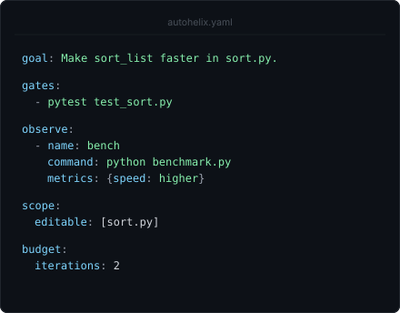
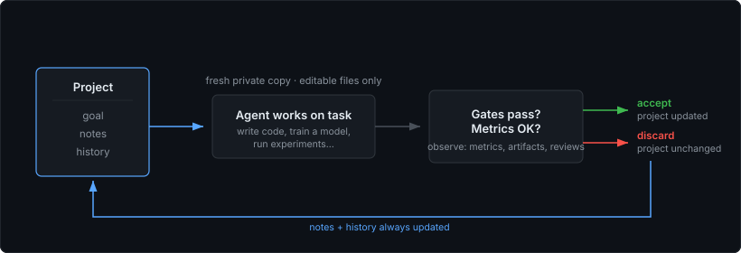
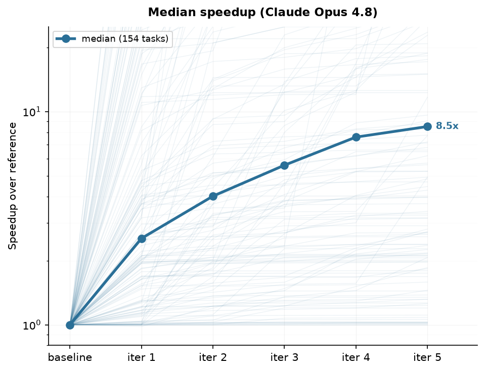
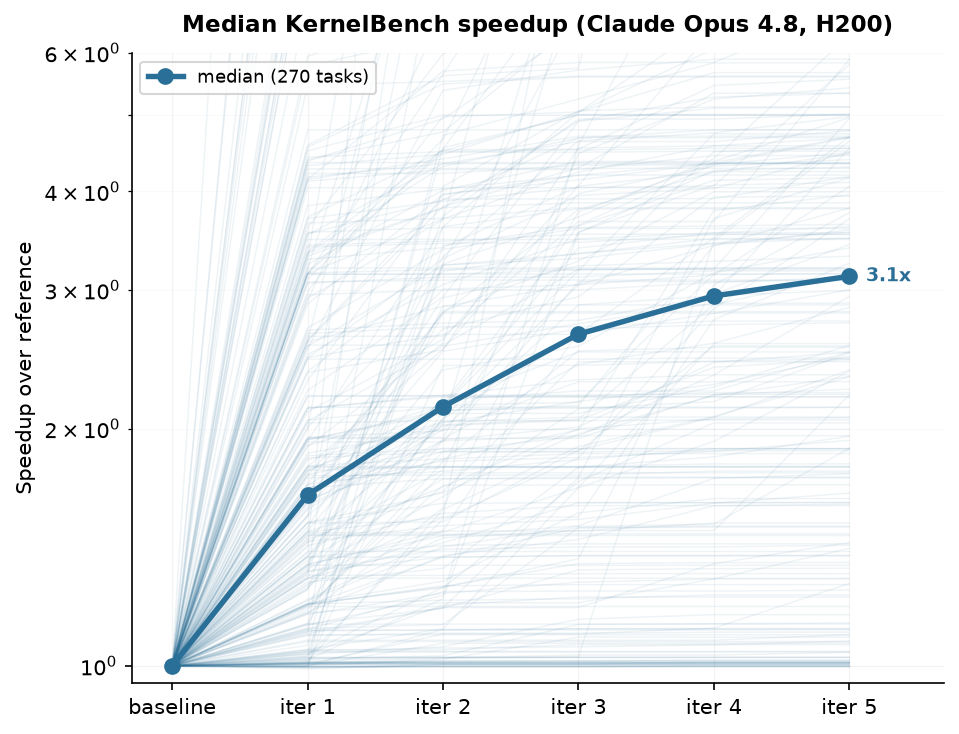
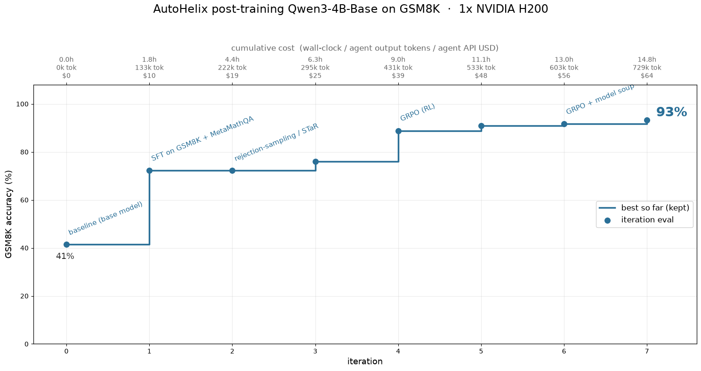
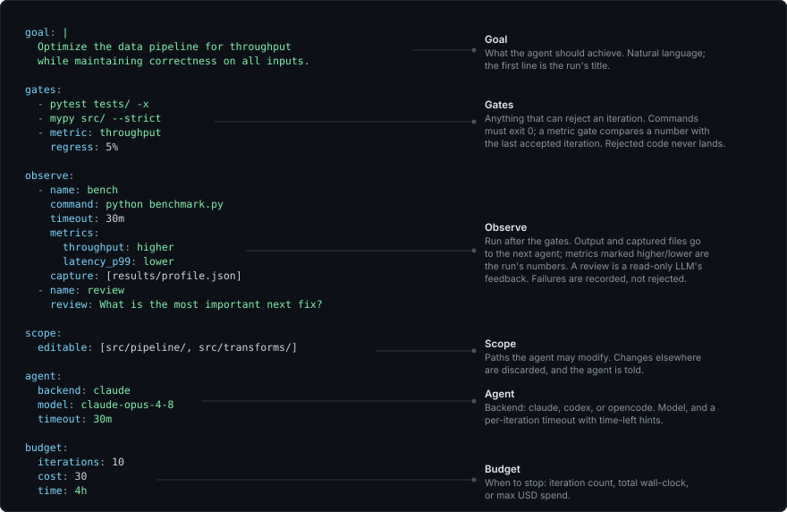

<p align="center">
  <picture>
    <source media="(prefers-color-scheme: dark)"  srcset="assets/autohelix-dark.svg">
    <source media="(prefers-color-scheme: light)" srcset="assets/autohelix-light.svg">
    
  </picture>
</p>

<p align="center"><b>Put an AI agent in a verified improvement loop.</b></p>

<p align="center">
  Set <b>gates</b> and what to <b>observe</b>; the agent proposes changes in a loop. <br>
  Only changes that pass the gates are accepted. Improvements compound across iterations.
</p>

<p align="center">
  works with <b>Claude Code · Codex · OpenCode</b>
</p>

<p align="center">
  
  
</p>

<p align="center">
  <a href="#how-it-works">How it works</a> ·
  <a href="#quick-start">Quick start</a> ·
  <a href="#examples">Examples</a> ·
  <a href="#configuration">Configuration</a> ·
  <a href="#other-features">Other features</a> ·
  <a href="#faq">FAQ</a>
</p>

<!-- ───────────────────────── DEMO ───────────────────────── -->
<table align="center"><tr>
<td></td>
<td></td>
</tr></table>

---

AutoHelix is a lightweight harness that lets you point an agent at a goal and leave it
looping unattended. It provides the isolation, validation, scope, and budget control to
make that safe, and it's general enough for any measurable goal, from optimizing
code to training models.

Looping an agent can be far more effective than a single prompt, because later iterations
fix and build on what came before, and because it gives you a knob for controlling how much
effort (time or cost) to put toward the goal rather than letting the agent decide when it's
done. AutoHelix makes this pattern easy to run and customize, so you can let the agent
climb for as long as you want.

## How it works

<p align="center">
  
</p>

You define a **goal**, the **gates** a change must pass, and what to **observe**
(benchmarks, reviews, artifacts). The agent proposes changes and the harness
decides if they land.

Core features:

- **Isolation.** Each iteration runs in fresh private copies of the code. A rejected attempt's code is cleanly discarded, and what was checked is exactly what gets accepted.
- **Scope enforcement.** Only files marked `editable` can be changed; changes elsewhere are discarded, and the agent is told.
- **Gates decide.** Tests, type-checks, any command that must exit 0, a yes/no question to a read-only agent (`ask:`), or a metric compared with the last accepted iteration. Fail a gate and the iteration is rejected; its change is kept aside for the next agent as a patch.
- **Observations inform.** Benchmarks, logs, artifacts and LLM reviews are saved by name and shown to the next iteration; their numbers are the run's metrics.
- **Persistent memory.** Each iteration is a fresh session, but the agent reads and writes notes that survive across all iterations, including rejected ones.
- **Budget control.** Cap the run by iterations, time, or cost. Codex cost uses an
  API-equivalent estimate; see [cost tracking](docs/config.md#cost-tracking).
- **Stop conditions.** Optional `stop:` commands end the run when one exits 0,
  checked on the baseline and after accepted iterations. Use a script, a metric
  (`jq -e '.missing == 0' "$AUTOHELIX_METRICS"`) or
  `autohelix ask -- "Is the goal complete?"`; see [stop conditions](docs/config.md#stop).

## Quick start

Install from source:

```bash
git clone https://github.com/awslabs/AutoHelix.git
cd AutoHelix
python -m venv .venv && source .venv/bin/activate
pip install -e .
```

Or `pip install autohelix` for the CLI and portable setup skill, without the
repository's example projects.

AutoHelix uses Claude Code by default (looks for `claude` on your `PATH`). Codex and
OpenCode are also supported — see [agent setup](docs/getting-started.md#agent-setup).

To prepare the experiment with your existing coding agent, install the packaged
skill into the target project:

```bash
autohelix skill install --agent codex --scope project --path my-project
# Use --agent claude or --agent opencode for those agents.
```

Your coding agent helps define the experiment. AutoHelix runs repeated attempts
using the configured scope, gates, and observe entries.

1. **Prepare and review**

   > Set up AutoHelix to improve [goal]. [Optional instructions.]

   The agent proposes the experiment, shows the complete config file, and
   walks through its choices without launching. Review what can change, what
   must pass (gates), what is observed, and the effective budgets.

2. **Run and manage**

   > Run and manage AutoHelix using the existing config. [Optional changes or budget limits.]

   The agent applies agreed changes to the configuration and supervises the run
   through termination.

Replace `[goal]` with the desired outcome and add any scope, evaluation, or
budget preferences. You can also ask the agent to set up and manage the
experiment in one request.

The complete skill and its references ship with
pip/wheel installs; no AutoHelix checkout is needed. Installation is explicit,
and existing skill folders are preserved unless you pass `--force`.
See the [conversational walkthroughs](docs/getting-started.md#with-your-coding-agent)
and [skill installation and export](docs/cli.md#autohelix-skill).

Or start from the project itself:

```bash
cd my-project
autohelix setup
```

In a terminal it asks whether to set up the loop with an agent (it starts
Claude Code, Codex or OpenCode with the bundled skill, nothing installed) or to
write an empty config, the commented template `autohelix.yaml`. Edit it using
the [configuration reference](#configuration), review and commit the intended
setup changes, then launch with `autohelix run`. For several loops in one
project, `autohelix setup perf` writes `autohelix/perf.yaml`, which
`autohelix run perf` runs. Other commands are described in the
[CLI reference](docs/cli.md).

## Examples

The [`examples/`](examples/) directory includes concrete tasks ranging from
review-driven refinement to workflow and algorithm optimization. To list
what's available:

```bash
python examples/setup_example.py --list
```

**Code optimization.** AutoHelix can iteratively improve the performance of
existing code while preserving user-defined correctness checks. We tested
this capability on two established benchmarks:
[AlgoTune](https://github.com/oripress/AlgoTune) for CPU algorithms and
[KernelBench](https://github.com/ScalingIntelligence/KernelBench) for GPU
kernels. In both evaluations, median speedup increased with each iteration,
reaching approximately **8.5× across 154 AlgoTune tasks** and **3.12× across
270 KernelBench tasks** after five iterations.

<table align="center">
<tr>
<td align="center"><br><sub>AlgoTune · CPU algorithms</sub></td>
<td align="center"><br><sub>KernelBench · GPU kernels</sub></td>
</tr>
</table>

Both runs used Claude Opus 4.8; KernelBench ran on an H200. The AlgoTune result
uses our own evaluation setup, which is not identical to its official harness.
See the [`examples/algotune`](examples/algotune) and
[`examples/kernelbench`](examples/kernelbench) setups, plus the
[`results/algotune`](results/algotune) and
[`results/kernelbench`](results/kernelbench) methodology and per-task results.

**Model training.** The same loop works when each iteration is a training run rather than a
code edit: the agent writes the training code and trains a model, and AutoHelix scores the
result with a frozen eval the agent can't modify. In
**[`examples/posttrain`](examples/posttrain)**
(inspired by [PostTrainBench](https://posttrainbench.com/)), the agent is asked to post-train
`Qwen3-4B-Base` on GSM8K. Given an open-ended goal (no method prescribed), the agent
worked its way up from supervised fine-tuning through rejection sampling to reinforcement
learning (GRPO) — reaching **93%** accuracy over 8 iterations on one H200. See the
**[ML Experiments Guide](docs/ml-experiments.md)** for setup tips.

<p align="center">
  
</p>

**Advanced agent loops.** AutoHelix can also support longer-running autonomous
work. The [`research`](examples/research) example iterates through experiments,
evidence, and reports; [`task-queue`](examples/task-queue) works through a
persistent list of coding tasks; and
[`workflow-optimization`](examples/workflow-optimization) improves a
model-powered workflow's prompts, skills, context, and orchestration against a
frozen evaluator.

**In the wild.** Beyond the bundled examples, we've used AutoHelix on real projects. In
[Hybrid Model Factory](https://github.com/awslabs/hybrid-model-factory) — an open-source
toolkit for training hybrid architectures (Attention + SSMs) from our team — the agent
autonomously developed a faster sequence-parallelism implementation. Over multiple runs
(with some algorithmic hints in the goal), it arrived at a state-passing approach that
propagates recurrent state between GPUs instead of redistributing the full sequence,
reaching **~5× faster per layer** and **1.6× faster end-to-end training** at 128K
sequence length on a 27B model.

<!-- ───────────────────── CONFIGURATION ───────────────────── -->

## Configuration

A run is defined by a single config file, `autohelix.yaml` (or
`autohelix/<name>.yaml`, one per loop). Every field is documented in
[docs/config.md](docs/config.md).

<p align="center">
  
</p>

<details>
<summary>The same config as text</summary>

```yaml
goal: |
  Optimize the data pipeline for throughput
  while maintaining correctness on all inputs.

gates:                       # anything that can reject an iteration
  - pytest tests/ -x
  - mypy src/ --strict
  - metric: throughput
    regress: 5%              # at most 5% worse than the last accepted iteration

observe:                     # feedback for the next agent, numbers for the harness
  - name: bench
    command: python benchmark.py   # prints ##autohelix[throughput=...]
    timeout: 30m
    metrics:
      throughput: higher
      latency_p99: lower
    capture: [results/profile.json]
  - name: review             # a read-only LLM review of the change
    review: What is the most important next fix?

scope:
  editable: [src/pipeline/, src/transforms/]

agent:
  backend: claude
  model: claude-opus-4-8
  timeout: 30m

budget:
  iterations: 10
  cost: 30
  time: 4h
```

</details>

Gates run first, in order; observe entries run next, and a failing one doesn't
reject anything (unless a `metric:` gate needs its number). Configs from earlier
versions (`constraints:`, `metrics:`, `reviewer:`, ...) are errors that name
their replacement; see [Old → new](docs/config.md#old--new).

**Project layout**

```
my-project/
├── autohelix.yaml       # your config (or autohelix/<name>.yaml, one per loop)
└── .autohelix/          # runtime state (gitignored)
    ├── current          # selected run id
    ├── runs/<id>/       # one persistent state directory per run
    │   ├── run.json     # identity, starting commit, target branch
    │   ├── history.jsonl # results and each model call's usage/log
    │   ├── notes/       # agent's persistent notes
    │   ├── observations/ # each observe entry's output, by iteration and name
    │   ├── hints.md     # messages from `autohelix hint`
    │   ├── logs/        # iter-N/call-*/ prompts and transcripts
    │   ├── output/      # report.md and report.html
    │   └── runtime/     # live status and per-run settings
    └── runtime/         # helper scripts and lock files
```

Temporary per-phase candidate copies live outside the project, in
`${XDG_CACHE_HOME:-~/.cache}/autohelix/copies/` (set `AUTOHELIX_COPIES_ROOT` to move them).

Each `autohelix run` starts a new run; `autohelix resume [<id>] [-n MORE]` continues
one, `autohelix archive <id>` sets one aside and `autohelix delete <id>` removes it.
Use `--land manual` to keep validated commits on the run's `refs/autohelix/<id>` until
`autohelix land`. By default, accepted changes land on the starting branch when a run
segment (one invocation) ends. A resumed run can coexist with unrelated dirty checkout
files. See [CLI reference](docs/cli.md#autohelix-run).

<!-- ───────────────────── OTHER FEATURES ───────────────────── -->

## Other features

<details>
<summary><b>Report</b></summary>

When a run finishes, an agent reads the run's history, notes, logs and commits and
writes a short summary to `.autohelix/runs/<id>/output/report.md`. `autohelix report` writes it on
demand, e.g. after an interrupted run. See [Configuration → Report](docs/config.md#report).

</details>

<details>
<summary><b>Reviews and progress tracking</b></summary>

Beyond benchmarks, an `observe:` entry with `review: <prompt>` gets qualitative feedback
from a read-only LLM on exactly the candidate (`autohelix review`, also usable by hand).
Each review is saved with the iteration's observations and the next agent reads it. With
`previous: true` and `metrics: {missing: lower}`, a review keeps its own status of a
worklist across accepted iterations, and `stop:` can end the run when the number reaches
zero. See [Concepts → Reviews](docs/concepts.md#reviews) and
[Progress tracking](docs/concepts.md#progress-tracking).

</details>

<details>
<summary><b>Viewer and run page</b></summary>

`autohelix view` follows a run in the terminal: its status and iterations, with the
agent's live output below; `autohelix dashboard` lists all runs. `autohelix view --web`
serves a live page for a run on 127.0.0.1: status, metric chart, iterations with gates,
notes, diffs, observations (reviews included) and agent activity, and the run summary once it is written. When a run stops, AutoHelix saves the same page as one file,
`.autohelix/runs/<id>/output/report.html`, to open in a browser or share. See
[Concepts → Run page](docs/concepts.md#run-page).

</details>

<details>
<summary><b>Time limits</b></summary>

Two time controls:

- **`budget.time`** — caps *total* wall-clock for the whole run. Checked before each
  iteration starts; doesn't interrupt one in progress.
- **`agent.timeout`** — per-iteration deadline, a hard kill. Where the backend supports
  it, a hook injects a countdown into the agent's context after each tool call, so it can
  wrap up and write notes before the deadline hits.

See [Config → Agent](docs/config.md#agent) and [Budget](docs/config.md#budget).

</details>

<details>
<summary><b>Docker sandbox</b></summary>

Optionally run AutoHelix inside Docker for filesystem isolation. The agent can't reach
your home directory, SSH keys, or other projects. Build the image with `docker/build.sh`
and run via `docker/run.sh`. See [Docker sandbox](docs/docker.md).

</details>

<details>
<summary><b>Hints</b></summary>

`autohelix hint "..."` (run in a second terminal) drops a note the running agent picks up
at the start of its next iteration. Useful to steer a run without stopping it. See
[CLI → hint](docs/cli.md#autohelix-hint).

</details>

<details>
<summary><b>Full customization</b></summary>

Beyond `autohelix.yaml`, you can replace the full per-iteration prompt template
(`prompt_template:`, with a documented set of variables) and control how the agent
organizes its persistent notes. See [Concepts → Prompt](docs/concepts.md#prompt) and
[Concepts → Notes](docs/concepts.md#notes).

</details>

<details>
<summary><b>Several runs at once</b></summary>

Runs started with `autohelix run --group NAME` run side by side in one project and see each
other's notes, history and accepted code at the start of every iteration. Compare them on
`autohelix dashboard`, `autohelix land` the winner and `autohelix archive` the rest. See
[CLI → Groups](docs/cli.md#groups).

</details>

<!-- ───────────────────────── FAQ ───────────────────────── -->

## FAQ

<details>
<summary><b>How does AutoHelix differ from other "agent in a loop" tools?</b></summary>

Running AI agents iteratively is becoming a popular strategy — a kind of test-time scaling
for agents, where more iterations buy more quality. Tools like
[autoresearch](https://github.com/karpathy/autoresearch),
[Ralph](https://github.com/snarktank/ralph), and Claude Code's
`/goal` and `/loop` commands each implement variations of this pattern.

Compared to other tools, AutoHelix adds a minimal amount of structure to ensure that long-running autonomous loops don't go off track, so you can let your agent work while keeping control over the direction.


| | AutoHelix | autoresearch | Ralph | `/goal` | `/loop` |
|--|--|--|--|--|--|
| Goal-directed | ✓ any metric(s) | ✓ val loss | ✓ task list | ✓ boolean | ✗ |
| Agent-agnostic | ✓ | ✓ | ✓ | ✗ | ✗ |
| Validation gates | ✓ | ~ self-checks | ✗ | ✗ | ✗ |
| Isolation on failure | ✓ private copy | ~ self-resets | ✗ | ✗ | ✗ |
| Fresh context each iteration | ✓ | ✗ | ✓ | ✗ | ✗ |
| Memory across iterations | ✓ notes, metrics, artifacts | session | progress file | session | session |
| Scope enforcement | ✓ | ~ by instruction | ✗ | ✗ | ✗ |
| Budget control | ✓ iters, time, cost | ✗ | iters only | iters only | ✗ |
| Time-aware agent | ✓ | ✗ | ✗ | ✗ | ✗ |
| Parallel exploration | ✓ | ✗ | ✗ | ✗ | ✗ |


</details>

<details>
<summary><b>What about reward hacking?</b></summary>

The agent optimizes what you measure: if your benchmark has loopholes, the agent may find
and exploit them, and more iterations apply more pressure to do so. Autonomous loops shift
the burden from "write perfect code" to "write strong checks."

You can look out for gaming by reading `autohelix report`, the agent's notes, or a
[review](docs/concepts.md#reviews)'s feedback. Then close the loophole with a new
gate and re-run.

</details>


<details>
<summary><b>Is it safe to run unattended?</b></summary>

AutoHelix isolates the agent at two levels:

1. **Candidate copies** (default) — each phase of an iteration runs in a separate private
   copy, outside your project, with its own git metadata. Rejected iterations never reach your branch (their trees
   stay on hidden refs until the run is deleted); accepted ones are recorded on the run ref
   and landed separately.
2. **Docker sandbox** (optional) — filesystem isolation: the agent can't access your
   home directory, SSH keys, or other projects. (Network is not isolated, since the
   agent needs it to reach the model API.)

Copy isolation protects your codebase from bad iterations, but it is **not a
security sandbox** — the agent still runs on your host and could in principle access
the filesystem or network. For focused optimization tasks (the typical use case), the
agent works toward a narrow goal, not exploring adversarially, so running without a
sandbox is usually a reasonable tradeoff. For stronger guarantees, or on sensitive
machines, use the Docker mode.

</details>

## Contributing & feedback

We'd love to hear how you're using AutoHelix — the goals you point it at, patterns
you wish it supported, or rough edges you hit. Please
[open an issue](https://github.com/awslabs/AutoHelix/issues) for bugs, ideas, or
use cases you'd like to share. Contributions are welcome.

## Citation

```bibtex
@software{autohelix2026,
  title   = {AutoHelix: Verified Iteration for AI Agents},
  author  = {Trager, Matthew and Mansimov, Elman and Zhang, Yi and Xia, Wei and Soatto, Stefano},
  year    = {2026},
  version = {0.1.1},
  url     = {https://github.com/awslabs/AutoHelix}
}
```

## License

AutoHelix is licensed under the [Apache License 2.0](LICENSE).
