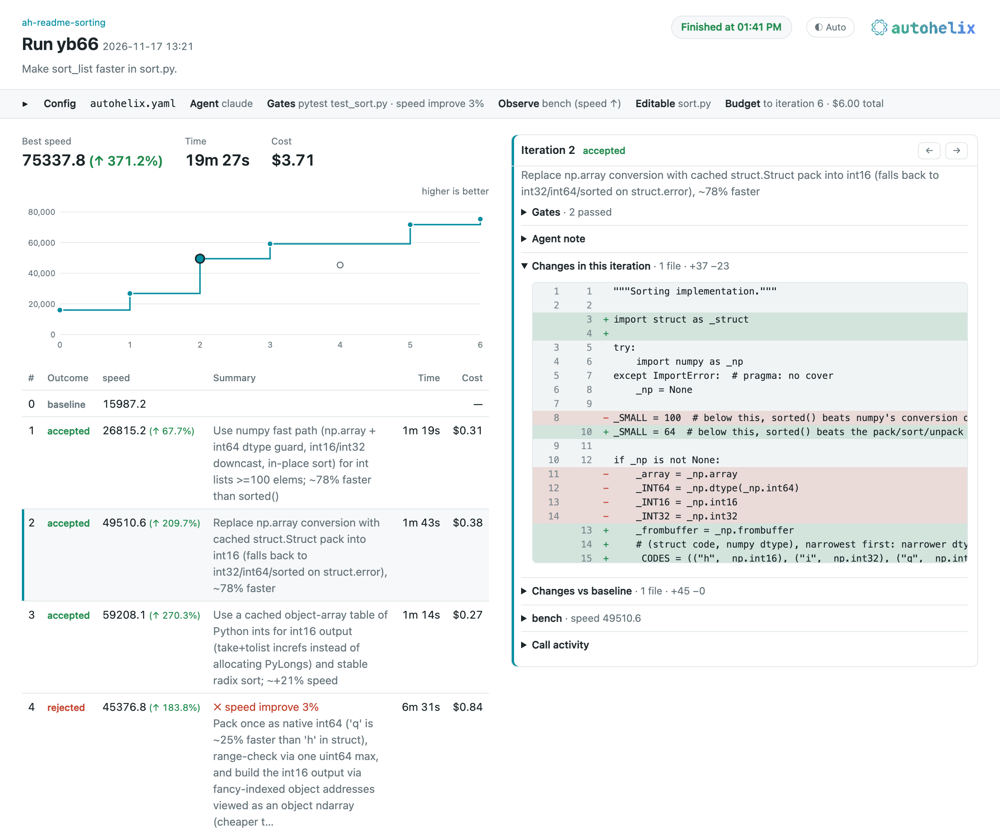

<p align="center">
  <picture>
    <source media="(prefers-color-scheme: dark)"  srcset="assets/autohelix-dark.svg">
    <source media="(prefers-color-scheme: light)" srcset="assets/autohelix-light.svg">
    
  </picture>
</p>

<h3 align="center">Run agents with protocols, not prompts.</h3>

<p align="center">
  Set the goal, the checks, and what to observe.<br>
  Your agent iterates until your budget runs out or the goal is met.<br>
  Every attempt is isolated, checked and recorded.<br>
  Follow its progress through metrics, diffs and notes.
</p>

<p align="center">
  works with <b>Claude Code · Codex · OpenCode</b>
</p>

<p align="center">
  
  
</p>

<p align="center">
  <picture>
    <source media="(prefers-color-scheme: dark)"  srcset="assets/run-page-dark.png">
    <source media="(prefers-color-scheme: light)" srcset="assets/run-page-light.png">
    
  </picture>
</p>

## Quickstart

In your project (a git repository), with its environment active:

```bash
git clone https://github.com/awslabs/AutoHelix.git ~/AutoHelix
pip install -e ~/AutoHelix
```

**1. Set up.** Your agent drafts the protocol with you and commits it.

```bash
autohelix
```

**2. Run.** Accepted changes land on your branch when the run ends.

```bash
autohelix run -n 3        # a baseline, then three attempts
autohelix run --cost 20   # or a budget in dollars
autohelix run --time 2h   # or in time
autohelix resume -n 5     # continue the run
```

<p align="center">
  
</p>

**3. Follow it.** Metrics, diffs, notes and costs, in your browser.

```bash
autohelix view --open     # --terminal to follow here instead
```

## How it works

### The protocol

A protocol is a config file with four parts:

- **Goal:** what the agent should achieve, in plain words.
- **Scope:** the files it may change. Everything else stays as it is, including the checks.
- **Gates:** what a change has to pass to be kept. That can be tests, type checks, any
  command that must exit 0, a yes/no question to a read-only agent, or a metric that
  mustn't get worse.
- **Observations:** what to measure and show the next iteration, such as benchmarks, logs,
  artifacts or written reviews. Their numbers become the run's metrics.

You can also add **stop conditions** that end the run once the goal is met, for example
when a metric reaches a target or a reviewer agent says the work is done.

The setup drafts the file with you. AutoHelix stores a copy with each run, so the protocol
can't change halfway through, and you can rerun the same protocol with another model to
compare.

<details>
<summary>What a config looks like</summary>

```yaml
# autohelix/perf.yaml
goal: Make the data pipeline faster without changing its output.

scope:
  editable: [src/pipeline/]

gates:
  - pytest tests/
  - ask: Does the change keep the public API?    # a read-only agent answers yes/no

observe:
  - name: bench
    command: python bench.py        # prints ##autohelix[throughput=1234]
    metrics: {throughput: higher}
  - name: review
    review: What is the most important next fix?
```

```bash
autohelix run perf -n 10            # or --cost 20, --time 2h
```

</details>

### Each iteration

A run repeats the same step: the agent makes an attempt at the goal, and the attempt is
checked and recorded. Each iteration starts from the last accepted one, so progress builds
up over the run.

1. The agent starts a fresh session in a **private copy** of your code, outside your
   project, with the goal, the results of earlier iterations and its own notes.
2. When it's done, its change is frozen, and anything it edited outside the scope is reset.
3. The gates run on a fresh copy of **exactly that change**, followed by the observations.
4. If every gate passes, the change is committed on the run and the next iteration builds
   on it. If not, it's set aside, and the next agent gets the patch along with the reason
   it failed.

The agent's notes carry over between iterations, including rejected ones. Your own
checkout isn't touched while the run works: accepted changes land on your branch when the
run ends or, with `--land manual`, when you run `autohelix land`.

Even a single iteration (`-n 1`) is useful: you get one isolated attempt, checked and
recorded.

### The record

AutoHelix records every attempt: its diff, cost, metrics and gate results, why it was
rejected, the reviews it got, and the agent's notes. All of it is plain files in
`.autohelix/runs/<id>/`, with a local web view on top. When the run ends, an agent reads
the record and writes a report of what was tried, what worked and what it cost.

## Why not just a loop?

A `while` loop around `claude -p` takes a few lines to write. Here's what such a loop
usually gets wrong, and what AutoHelix does instead:

| A homemade loop | AutoHelix |
|---|---|
| Tests pass in the agent's working folder, with files that never get committed. | The gates run on a fresh copy of exactly the tree that will be committed. |
| By iteration 14, the agent has quietly edited the benchmark. | Only files in scope can change, and the config and its checks are frozen. |
| A failed attempt is thrown away, along with what it learned. | Its patch goes to the next iteration, and the agent's notes survive rejections. |
| The context fills up, and compaction drops the important part. | Every iteration is a fresh session; what carries over is files: code, notes and results. |
| You come back to a branch in an unknown state. | Your checkout isn't touched until checked work lands. |
| Nobody knows what happened overnight, or what it cost. | Every attempt is recorded with its cost, and a report sums up the run. |
| It stops when the agent says it's done. | It stops when your budget runs out, or when a stop condition you wrote says so. |

**Compared with Ralph loops, `/goal` or autoresearch.** These share the basic idea of
keeping an agent working toward one goal. Where AutoHelix differs is in who decides what
counts and what gets kept: the checks run outside the agent, on an isolated copy of exactly
its change; the protocol is stored with the run; and every attempt is recorded, whether it
was kept or not, so you can follow a run, pick it up later and compare it with others.

**Compared with subagents and multi-agent workflows.** These work at a different level, and
the two combine well: a workflow decides how a single attempt is made, while AutoHelix
decides what happens between attempts. The agent in each iteration is a full Claude Code,
Codex or OpenCode session, so it can use subagents and skills as usual. What changes is that
it doesn't check its own work: the gates run outside it, on the frozen change.

## Features

Roughly in order of how often you'll need them; the last few are more experimental.

| | |
|---|---|
| **Agent judges** | `ask:` gates put a yes/no question to a read-only agent; `review:` entries get written feedback on exactly the candidate, saved for the next iteration. [→](docs/concepts.md#reviews) |
| **Progress tracking** | A reviewer keeps a running count of what's left in a spec or worklist, and a stop condition ends the run when it reaches zero. [→](docs/concepts.md#progress-tracking) |
| **Resume and steer** | `resume` continues a run with its stored protocol; `hint` sends the running agent a message for its next iteration; `stop` ends the run after the current one. [→](docs/cli.md) |
| **Runs side by side** | Start several runs of one protocol (other models, budgets or prompts) with manual landing, compare them in `autohelix view`, and `land` the best. [→](docs/cli.md#autohelix-land) |
| **Three agents** | Claude Code, Codex and OpenCode; reviewers can use a different one from the main agent. [→](docs/getting-started.md#agent-setup) |
| **Docker sandbox** | Optionally run the agent in a container with no access to your home directory or other projects. [→](docs/docker.md) |
| **Groups** | Runs in a group see each other's notes, history and accepted code at every iteration, so parallel runs build on each other's work. [→](docs/cli.md#groups) |
| **Import** | Start a new run from where another one got to, for example with a revised protocol. [→](docs/cli.md#autohelix-run) |
| **Scripting** | `autohelix wait` blocks until a run event and prints it as JSON, so a script or a supervising agent can follow runs without polling. [→](docs/cli.md#autohelix-wait) |
| **Custom prompt** | Replace the per-iteration prompt template, with a documented set of variables. [→](docs/concepts.md#prompt) |

## What you can use it for

Anything you can check, numbers or not:

- **Make a number go up.** Speed, accuracy, memory, cost, under tests that must keep
  passing. ([sorting](examples/sorting), [AlgoTune](examples/algotune), [KernelBench](examples/kernelbench))
- **Work through a list.** A frozen spec or backlog; a reviewer counts what's still
  missing and the run stops at zero. ([task-queue](examples/task-queue))
- **Fix it until it passes.** A reproducer that must pass, retried in fresh attempts.
- **Improve an agent or workflow.** Prompts, skills, tools and orchestration of an LLM
  system, scored by a frozen evaluator. ([workflow-optimization](examples/workflow-optimization))
- **Train a model.** Each iteration writes training code and trains; a frozen eval scores
  the result. ([posttrain](examples/posttrain))
- **Research and writing.** Experiments, evidence and a report, judged by a read-only
  reviewer. ([research](examples/research), [writing](examples/writing))

## Results

**Iterations keep paying off.** On two code-optimization benchmarks, median speedup
rose with every iteration: ~8.5× on 154 [AlgoTune](https://github.com/oripress/AlgoTune)
tasks and 3.12× on 270 [KernelBench](https://github.com/ScalingIntelligence/KernelBench)
tasks after five iterations (earlier harness version, Claude Opus 4.8).

<table align="center">
<tr>
<td align="center"></td>
<td align="center"></td>
</tr>
</table>

**An open-ended goal, one H200.** Asked to post-train `Qwen3-4B-Base` on GSM8K with no
method prescribed, the agent went from supervised fine-tuning through rejection sampling
to GRPO, reaching **93%** in 8 iterations ([posttrain](examples/posttrain)).

<p align="center">
  
</p>

**In the wild.** In [Hybrid Model Factory](https://github.com/awslabs/hybrid-model-factory),
the agent developed a state-passing sequence-parallelism implementation: ~5× faster per
layer and 1.6× faster end-to-end training at 128K sequence length on a 27B model.

## Limits

- **Your checks are the verdict.** The agent optimizes what you measure, and more
  iterations put more pressure on loopholes. AutoHelix makes gaming visible (diffs,
  notes, reviews, the report) so you can tighten the checks; it can't make weak checks strong.
- **Copies are not a sandbox.** They protect your code from bad iterations, not your
  machine from the agent. Use the [Docker mode](docs/docker.md) on sensitive machines.
- **Agents are stochastic.** A rerun follows the same protocol and gets a new sample.

## Learn more

- [Getting started](docs/getting-started.md): install, agent setup, first run
- [Concepts](docs/concepts.md): iterations, notes, reviews, progress tracking, groups
- [Configuration](docs/config.md): every field
- [CLI](docs/cli.md): every command
- [ML experiments](docs/ml-experiments.md): training and eval loops

## Contributing & feedback

We'd love to hear what you point AutoHelix at. Please
[open an issue](https://github.com/awslabs/AutoHelix/issues) for bugs, ideas or use cases.

## Citation

```bibtex
@software{autohelix2026,
  title   = {AutoHelix: Running Coding Agents with Protocols},
  author  = {Trager, Matthew and Mansimov, Elman and Zhang, Yi and Xia, Wei and Soatto, Stefano},
  year    = {2026},
  version = {0.1.1},
  url     = {https://github.com/awslabs/AutoHelix}
}
```

## License

[Apache License 2.0](LICENSE).
