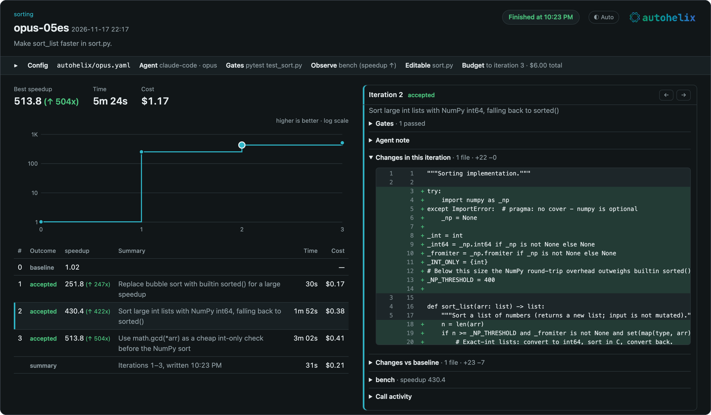
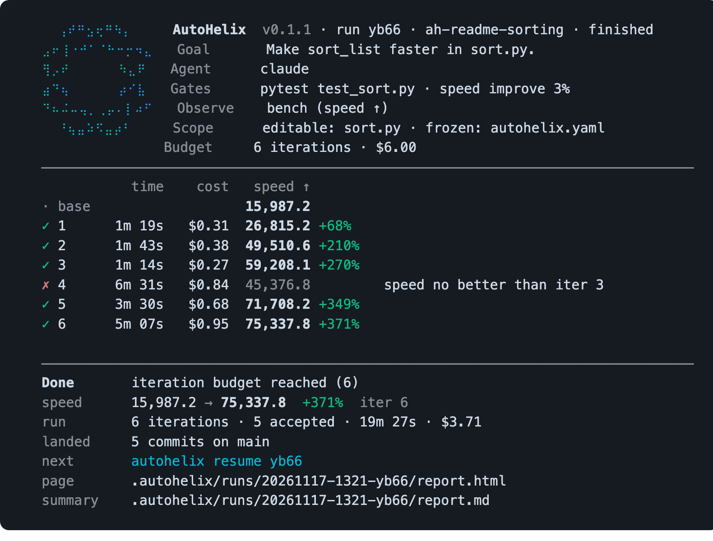
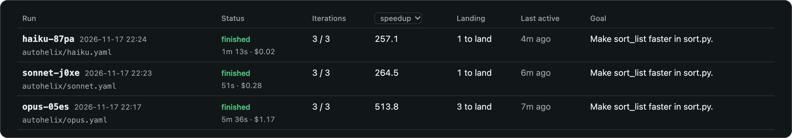
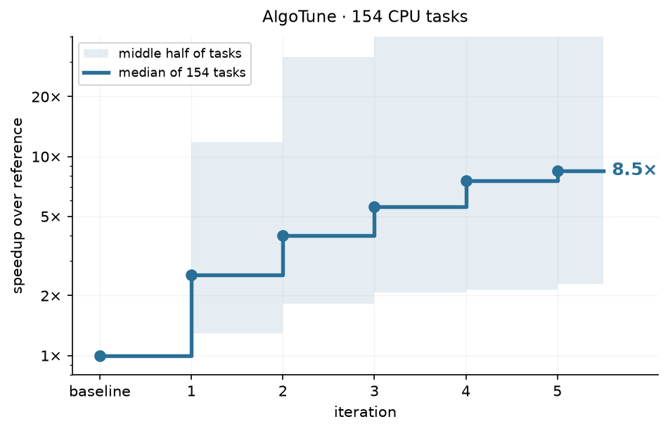
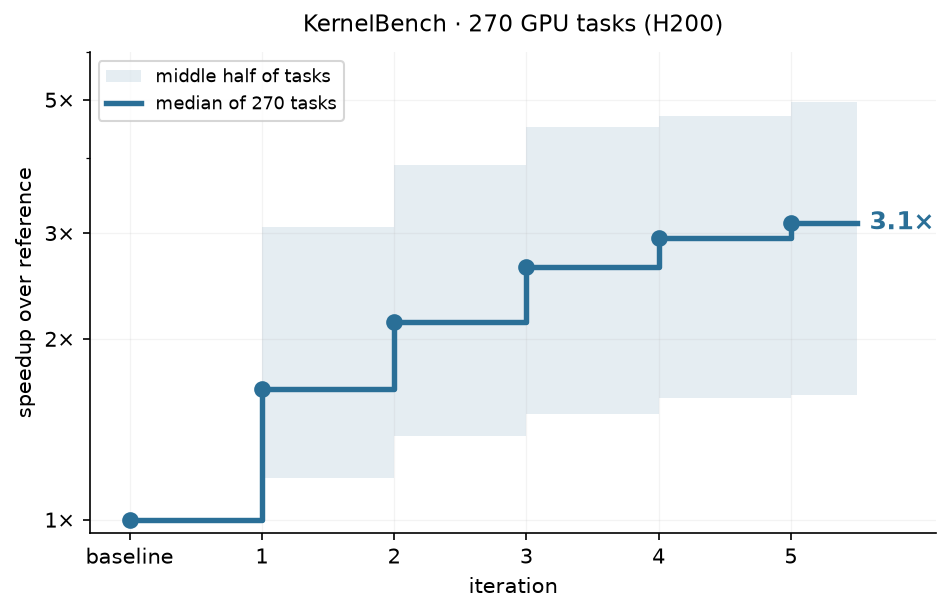
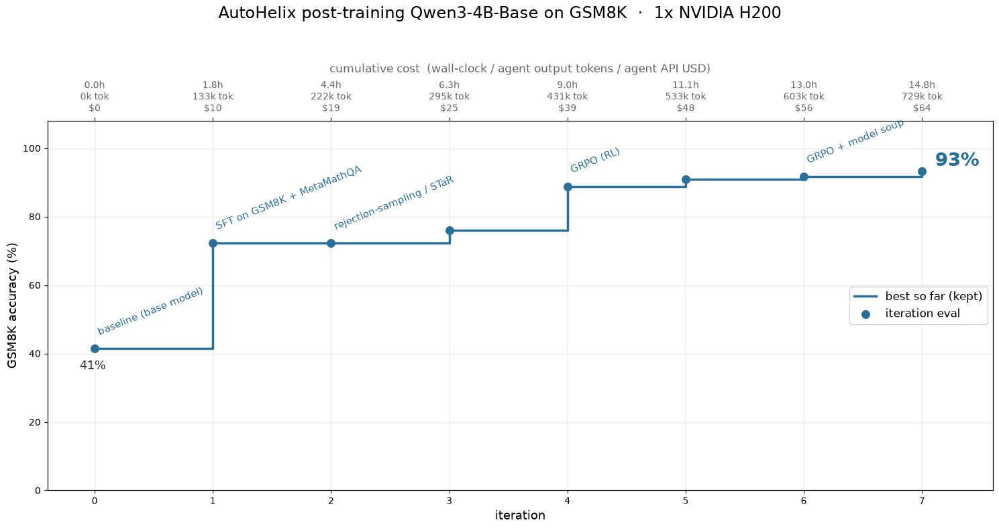

<p align="center">
  <picture>
    <source media="(prefers-color-scheme: dark)"  srcset="assets/autohelix-dark.svg">
    <source media="(prefers-color-scheme: light)" srcset="assets/autohelix-light.svg">
    
  </picture>
</p>

<h3 align="center">Run agents with protocols, not conversations.</h3>

<p align="center">
  One file sets the goal, the checks and what to observe.<br>
  The agent iterates until your budget runs out or the goal is met.<br>
  Track its progress through metrics, diffs and notes.
</p>

<p align="center">
  works with <b>Claude Code · Codex · OpenCode</b>
</p>

<p align="center">
  
  
</p>

<p align="center">
  
</p>

## Quickstart

In your project (a git repository), with its environment active and Claude Code, Codex or
OpenCode installed:

```bash
pip install git+https://github.com/awslabs/AutoHelix.git
```

**1. Set up.**

```bash
autohelix
```

An agent session opens and helps you turn your goal into a protocol: it looks at your
project, proposes the checks and what to measure, and saves the file once you agree.

**2. Run.** The setup agent ends by suggesting a command and budget, for example:

```bash
autohelix run -n 3        # three iterations (or --cost 20, --time 2h)
```

Each iteration prints a row with its time, cost and metrics. Accepted changes land on your
branch when the run ends. With `--land manual` they wait until you run `autohelix land`,
for example to review them first or to compare several runs. `autohelix resume` continues
a run later.

**3. Follow it.**

```bash
autohelix view --open
```

The web view lists all of the project's runs, live. Open one to see its metrics, diffs,
notes and costs, iteration by iteration.

**4. Ask about it.** Run `autohelix` again any time: it lists your runs and opens an agent
that can read them, answer questions and suggest what to try next.

## How it works

### The protocol

A protocol is a config file. Its four main parts:

- **Goal:** a short text saying what the agent should achieve.
- **Scope:** the files it may change. Edits to any other file are discarded before the
  checks run, so the agent can't change the tests or the benchmark.
- **Gates:** the checks a change has to pass to be kept. That can be tests, type checks,
  any command that must exit 0, a yes/no question to a read-only agent, or a metric that
  must improve or not get worse.
- **Observations:** what to measure and show the next iteration, such as benchmarks, logs,
  artifacts or written reviews. Their numbers become the run's metrics.

The file can also choose the agent and model, and add **stop conditions** that end the run
once the goal is met, for example when a metric reaches a target or a reviewer agent says
the work is done.

<details>
<summary>What a config looks like</summary>

```yaml
# autohelix/perf/config.yaml
goal: Make the data pipeline faster without changing its output.

scope:
  editable: [src/pipeline/]

gates:
  - pytest tests/
  - ask: Does the change keep the public API?    # a read-only agent answers yes/no

observe:
  - name: bench
    command: python bench.py        # prints ##autohelix[throughput=1234]
    metrics: {throughput: higher}
  - name: review
    review: What is the most important next fix?
```

```bash
autohelix run perf -n 10            # or --cost 20, --time 2h
```

</details>

### Each iteration

A run repeats one step: the agent makes an attempt at the goal, and the attempt is checked
and recorded. Each iteration starts from the last accepted one, so progress can build up over
the run. Even a single iteration (`-n 1`) can be useful as an isolated attempt that is checked and
recorded.

- The agent works in a fresh session, in a **private copy** of your code outside your
  project.
- When it's done, its change is frozen, and the gates run on a fresh copy of **exactly that
  change**, so files it left behind can't make them pass.
- If every gate passes, the change is committed on the run and the next iteration builds
  on it. If not, it's set aside, and the next agent gets the patch and the reason it failed.
- The agent's notes carry over to the next iteration, even when its change is rejected.
- Your checkout isn't touched while the run works: accepted changes land on your branch
  when the run ends or, with `--land manual`, when you run `autohelix land`.

### The record

Every iteration starts a fresh session, so the run's whole state is in files: the code, the
agent's notes and the results of earlier iterations. Nothing lives only in a context
window, and each iteration's prompt is saved too, so you can read exactly what every agent
was given.

AutoHelix records every attempt: its diff, cost, metrics and gate results, why it was
rejected and the reviews it got. It's all plain files in `.autohelix/runs/<id>/`, which the
web view shows and the `autohelix` agent reads when you ask about a run. When the run ends, an agent reads the record and writes a report of what
was tried, what worked and what it cost.

In the terminal, each iteration is a row with its time, cost and metrics:

<p align="center">
  
</p>

In the web view, runs of the same protocol can be compared side by side, here with three
models:

<p align="center">
  
</p>

## Why not just a loop?

A `while` loop around `claude -p` takes a few lines to write. Here's what such a loop
usually gets wrong, and what AutoHelix does instead:

| A homemade loop | AutoHelix |
|---|---|
| Tests pass in the agent's working folder, with files that never get committed. | The gates run on a fresh copy of exactly the tree that will be committed. |
| The agent quietly edits the tests or the benchmark until they pass. | Only files in scope can change, and the config and its checks are frozen. |
| A failed attempt is thrown away, along with what it learned. | Its patch goes to the next iteration, and the agent's notes survive rejections. |
| The context fills up, and compaction drops the important part. | Every iteration is a fresh session; what carries over is files: code, notes and results. |
| You come back to a branch in an unknown state. | Your checkout isn't touched until checked work lands. |
| Finding out what happened overnight, and what it cost, means digging through logs. | Every attempt's metrics, diff, notes and cost are in a live web view, and a report sums up the run. |
| It stops when the agent says it's done. | It stops when your budget runs out, or when a stop condition you wrote says so. |

**Compared with Ralph loops, `/goal` or autoresearch.** These share the basic idea of
keeping an agent working toward one goal. Ralph and `/goal` work toward a goal that is
either met or not (tests pass, a feature is done); autoresearch pushes a number (loss). A protocol covers both: gates for what must hold, metrics for what should improve,
and a stop condition for when it's done. The bigger difference is who decides what counts
and what gets kept: the checks run outside the agent, on an isolated copy of exactly its
change; the protocol is one file, committed with your code, that anyone can rerun; and
every attempt is recorded, whether it was kept or not, so you can follow a run, pick it up
later and compare it with other runs.

**Compared with subagents and multi-agent workflows.** These work at a different level, and
the two combine well: a workflow decides how a single attempt is made, while AutoHelix
decides what happens between attempts. The agent in each iteration is a full Claude Code,
Codex or OpenCode session, so it can use subagents and skills as usual. What changes is that
it doesn't check its own work, since the gates run outside it, on the frozen change.

## More features

| | |
|---|---|
| **Agent judges** | Read-only agents check, review or track progress on exactly the candidate: `ask:` gates answer a yes/no question, `review:` entries write feedback for the next iteration, and a review that sees its previous verdict keeps an independent count of what's left in a spec. Judges can use a different agent or model from the main one. [→](docs/concepts.md#reviews) |
| **Resume** | Continue a run later, with its stored protocol and a new budget. [→](docs/cli.md#autohelix-resume) |
| **Steer** | `hint` sends the running agent a note for its next iteration; `stop` ends the run after the current one. [→](docs/cli.md#autohelix-hint) |
| **Groups** | Parallel runs in a group read each other's notes and accepted code at every iteration, so they can build on each other's work. [→](docs/cli.md#groups) |
| **Docker sandbox** | Optionally run the agent in a container with no access to your home directory or other projects. [→](docs/docker.md) |

For everything else, see the [CLI](docs/cli.md) and [configuration](docs/config.md) references.

## What you can use it for

The goal can be anything you can check, with a script or with an agent:

| | Pass or fail | Better or worse |
|---|---|---|
| **Checked by a script** | Fix a failing test, finish a Lean proof | Speed up code, raise a model's accuracy, cut an agent's cost ([sorting](examples/sorting), [AlgoTune](examples/algotune), [KernelBench](examples/kernelbench), [posttrain](examples/posttrain), [workflow-optimization](examples/workflow-optimization)) |
| **Checked by an agent** | Implement every item of a spec, with a reviewer tracking what's missing ([task-queue](examples/task-queue)) | Improve research or writing, with a reviewer saying what to improve next ([research](examples/research), [writing](examples/writing)) |

Gates add the constraints. Whatever the goal, a change is kept only if it passes them: the
tests still pass, the public API stays the same, accuracy doesn't drop. In the sorting run
at the top, the speedup is the goal and pytest is the constraint. It's optimization under
constraints, with scripts or agents checking both.

## Results

**Iterations keep paying off.** On two code-optimization benchmarks, median speedup
rose with every iteration: ~8.5× on 154 [AlgoTune](https://github.com/oripress/AlgoTune)
tasks and 3.12× on 270 [KernelBench](https://github.com/ScalingIntelligence/KernelBench)
tasks after five iterations (earlier harness version, Claude Opus 4.8).

<table align="center">
<tr>
<td align="center"></td>
<td align="center"></td>
</tr>
</table>

**An open-ended goal, one H200.** Asked to post-train `Qwen3-4B-Base` on GSM8K with no
method prescribed, the agent went from supervised fine-tuning through rejection sampling
to GRPO, reaching **93%** in 8 iterations ([posttrain](examples/posttrain)).

<p align="center">
  
</p>

**In the wild.** In [Hybrid Model Factory](https://github.com/awslabs/hybrid-model-factory),
the agent developed a state-passing sequence-parallelism implementation: ~5× faster per
layer and 1.6× faster end-to-end training at 128K sequence length on a 27B model.

## Limitations

- **Your checks are the verdict.** The agent optimizes what you measure, and the more
  iterations you run, the harder it pushes on loopholes in your checks (reward hacking).
  AutoHelix makes gaming visible through diffs, notes, reviews and the report, and an
  `ask:` gate or a reviewer can look for it, but it can't make weak checks strong.
- **Copies are not a sandbox.** Each iteration's private copy protects your code from bad
  attempts, not your machine from the agent, which runs with your permissions. Use the
  [Docker mode](docs/docker.md) on machines with anything sensitive on them.
- **Agents are stochastic.** Even if the protocol stays the same, each run is a new sample,
  so results vary from run to run. Repeating runs makes the numbers more trustworthy.

## Learn more

- [Getting started](docs/getting-started.md): install, agent setup, first run
- [Concepts](docs/concepts.md): iterations, notes, reviews, progress tracking, groups
- [Configuration](docs/config.md): every field
- [CLI](docs/cli.md): every command
- [Examples](examples/README.md): ready-to-run projects, from sorting to post-training

## Contributing & feedback

We'd love to hear what you point AutoHelix at. Please
[open an issue](https://github.com/awslabs/AutoHelix/issues) for bugs, ideas or use cases.

## Citation

```bibtex
@software{autohelix2026,
  title   = {AutoHelix: Running Agents with Protocols},
  author  = {Trager, Matthew and Mansimov, Elman and Zhang, Yi and Xia, Wei and Soatto, Stefano},
  year    = {2026},
  version = {0.1.1},
  url     = {https://github.com/awslabs/AutoHelix}
}
```

## License

[Apache License 2.0](LICENSE).
