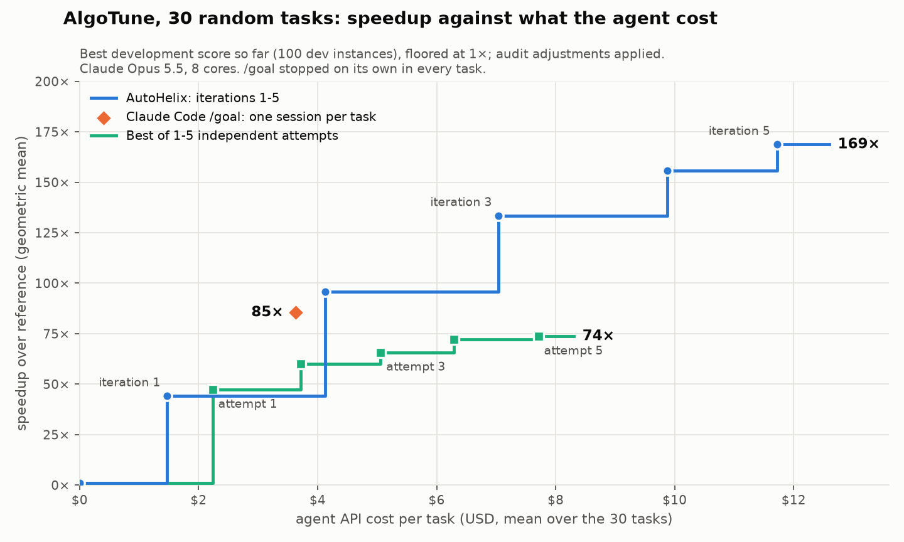
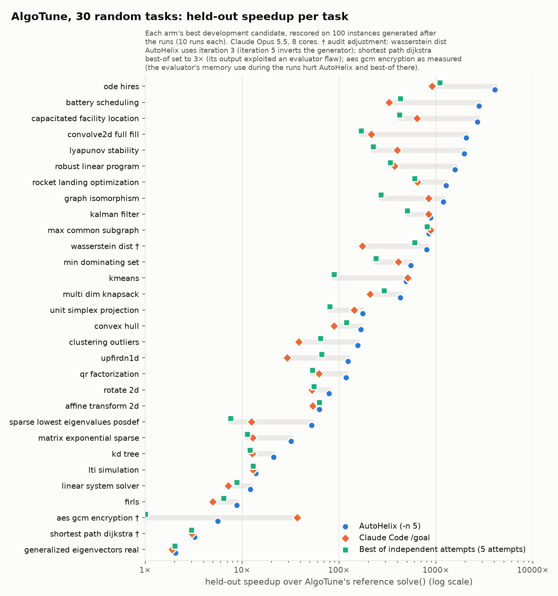

# AlgoTune: AutoHelix against resampling and one long session

[AlgoTune](https://github.com/oripress/AlgoTune) asks an agent to make a Python `solve()`
faster without changing what it returns: each task has a reference solver and an
`is_solution()` check, and the score is reference time / solver time, counted only when
every output passes. This folder holds the setup we used to compare three ways of running
the same agent on it, and the evaluator that scores them.

<p align="center">
  <picture>
    <source media="(prefers-color-scheme: dark)" srcset="../../assets/algotune_progress-dark.png">
    
  </picture>
</p>

**Same agent, same goal.** On 30 tasks drawn at random,
AutoHelix's iterations keep turning spend into speedup; the best of up to five independent
attempts levels off after the first; a Claude Code `/goal` session lands near the AutoHelix
curve at its own cost, then stops by itself. On held-out instances, AutoHelix after five
iterations is faster than the best of five attempts on **30 of 30** tasks (2.5× in
geometric mean) and faster than `/goal` on **27 of 30** (2.0×).

## Results

30 tasks sampled from AlgoTune's 154 (`subset-30.txt`, seed 20261119), Claude Opus 5.5,
November 2026. Each arm's best candidate on the development instances, rescored on 100
**held-out** instances generated after the runs (10 runs each). A speedup below 1× or an
invalid output counts as 1×.

| Arm | Agent cost (30 tasks) | Geometric mean | Median | Harmonic mean |
|---|---|---|---|---|
| AutoHelix, `-n 3` | $211 | 138× | 160× | 17.5× |
| **AutoHelix, `-n 5`** | **$352** | **173×** | **172×** | **21.2×** |
| Best of 3 independent attempts | $152 | 66× | 71× | 11.1× |
| Best of 5 independent attempts | $231 | 70× | 85× | 11.4× |
| Claude Code `/goal`, one session | $109 | 86× | 116× | 17.6× |

Paired over the same tasks (ratio of geometric means, 95% bootstrap interval over tasks):

- AutoHelix `-n 5` / best of 5: **2.47×** (1.93–3.22), faster on 30 of 30.
- AutoHelix `-n 3` / best of 3: 2.09× (1.70–2.62), faster on 28 of 30.
- AutoHelix `-n 5` / `/goal`: **2.02×** (1.49–2.70), faster on 27 of 30.
- At similar cost (AutoHelix after 2 iterations, about $4 a task, vs `/goal` at $3.6) the two
  are indistinguishable: 1.12× (0.78–1.49) on the development scores.

Held-out scores track the development scores closely (held-out / dev: 1.01 in geometric
mean over the scored candidates), so the curves above, drawn from the runs' own
development scores, hold on new instances.

The harmonic mean is AlgoTune's own aggregate. It is decided by the few tasks where every
arm stays near 2-10× (`generalized_eigenvectors_real` is about 2× for all three), which is
why the arms look closer there than in the geometric mean or the per-task wins.

<p align="center">
  <picture>
    <source media="(prefers-color-scheme: dark)" srcset="../../assets/algotune_tasks-dark.png">
    
  </picture>
</p>

The per-task numbers, costs and audit notes are in
[`results/algotune-comparison/results.json`](../../results/algotune-comparison/results.json);
[`make_plot.py`](../../results/algotune-comparison/make_plot.py) draws both figures from it.

## What was compared

Every arm ran Claude Opus 5.5 (Claude Code 2.1.328) in its own container per task, with the
same goal text, the same 100 development instances and the same evaluation command:

- **AutoHelix, `-n 5`:** one run of five iterations. Each iteration is a fresh agent call in
  a private copy; the evaluation (`sudo -n algotune-gate`, all development instances) runs
  after it, and the change is kept only if every output is valid. The next iteration sees
  the history, its notes and the last rejection. `-n 3` is the same runs after three.
- **Best of N independent attempts:** five separate one-iteration AutoHelix runs per task,
  so each attempt is exactly an AutoHelix first iteration; the score is the best of N.
  The curve averages over every choice of N of the five attempts.
- **Claude Code `/goal`:** one `claude -p "/goal <the same goal>"` session per task, with a
  $15 safety cap that no session reached (the most any spent was $10.70; every one stopped
  on its own). It could run the same evaluation itself as often as it liked.

Each container had 8 physical cores (Intel Xeon Platinum 8275CL), no GPU, 32 GB, and no
network beyond the model API. Thread variables started at 1, and agents were told they may
raise them (the reference stays single-threaded).

## How it is measured

[`evaluate.py`](evaluate.py) follows AlgoTune's protocol (fresh process per run, warm-up
on another instance, a new `Solver()` per call, timed: `Solver()`, `solve()` and
materializing the output; fastest run counts; every timed output is validated), with
changes so the score can't be forged from solver code:

- the clock is in a parent process that never imports the solver; the problem is delivered
  before the clock starts, with a check that the solver did no gross work while receiving it;
- the output comes back pickled through a socket, and a trusted echo process's round trip
  with the same output is subtracted;
- solver code runs as an unprivileged user that can't read the instances; the evaluator and
  AlgoTune are root's alone in the container.

Development instances are seed 1000 (100 per task); held-out instances use a fresh seed
chosen after the runs. Each held-out evaluation ran in a fresh container with no network.

## Audit

We read every scored candidate (143) before reporting, and scanned all of them for
tampering. **No candidate patches the evaluator, solves early, reads instance data or caches
answers.** Two results are adjusted in the figures and table above:

- **`shortest_path_dijkstra`, best of N:** the best-of attempts' 63× and 122× come from an
  evaluator flaw: they return the distance matrix as lists of shared numpy scalars, whose
  pickling is so expensive that the echo subtraction cancels the real work. Their plain cost
  is at most about 3×, and they count as 3×. (Fixing the evaluator for this is a follow-up.)
- **`wasserstein_dist`, AutoHelix iteration 5 (2817×):** it recognizes the generator's
  mixture of Gaussians from 48 sampled entries and answers in closed form without reading
  most of the input: correct on AlgoTune's instances, wrong on others. It counts as
  iteration 3's 803×.

`aes_gcm_encryption` is shown as measured, flagged: during the runs the evaluator held all
100 problems (29 GB) in memory, which killed most development evaluations in a 32 GB
container. That hurt AutoHelix (5.6×; its solver deliberately slows down to survive) and the
best-of attempts (none valid), not `/goal`. The evaluator now loads each problem when it is
needed.

Other findings, not adjusted because they hold on AlgoTune's own instances:

- **Tolerances:** several solvers stop at an optimality gap or integration tolerance chosen
  against `is_solution`'s (a 1% objective gap, `ode_hires` at 1e-7 against the reference's
  1e-10). `kmeans`'s fastest candidates (AutoHelix and `/goal` alike) run a few relaxed
  passes that rely on the generator's single cluster and a 5% loss allowance.
- **Hardware:** multithreading and SIMD against the single-threaded reference account for
  roughly 4-8× on the numeric tasks (linear algebra, convolution, signal processing) and
  almost nothing on the optimization, ODE and graph tasks.
- **Setup outside the clock:** memory pools allocated at import or during the warm-up call
  are common (legal under AlgoTune's protocol; worth up to ~2× on a few tasks).

## Caveats

- This is not an AlgoTune leaderboard score: our hardware, our evaluator, 30 of 154 tasks,
  and threads were allowed for every arm.
- One run per task for AutoHelix and `/goal`; the best-of attempts (five per task) show how
  much a single agent call varies.
- `/goal` decides by itself when it is done. A longer `/goal` session (told to keep going)
  would add points further along the cost axis; we didn't run that.

## Running it

The arms run in containers on a Linux host with Docker; [`run.py`](run.py) starts one
container per task on its own core set, and expects a short-term Bedrock API key minted
from the host's AWS credentials (`claude-bedrock`; with an Anthropic API key instead,
replace that wrapper):

```bash
# from the repository root, on the host
docker build -f examples/algotune/Dockerfile.evaluator -t algotune-eval examples/algotune  # AlgoTune at a pinned commit
docker build -f examples/algotune/Dockerfile.agent -t algotune-agent .
docker network create --subnet 172.30.0.0/16 algotune   # and block the metadata endpoint, see run.py

python3 examples/algotune/run.py data --tasks-file examples/algotune/subset-30.txt \
    --split dev --seed 1000 --out ~/algotune/data
python3 examples/algotune/run.py run --tasks-file examples/algotune/subset-30.txt \
    --arm autohelix --arg 5 --data ~/algotune/data --out ~/algotune/subset
# --arm best --arg 1 --attempt N (N = 1..5);  --arm goal --arg 15 (USD cap)
```

Then [`collect.py`](collect.py) gathers each arm's iterations, costs and commits, and
[`rescore.py`](rescore.py) picks each arm's best candidate (`pick`) and scores it on
held-out instances in fresh containers (`score`).

For a single task outside the comparison, [`setup.py`](setup.py) scaffolds a standalone
project (`<task>.py`, `solver.py`, `autohelix/algotune/config.yaml`) from an AlgoTune
checkout; its evaluation command expects the agent image, where the instances and the
evaluator are out of the agent's reach.

| File | What it is |
|---|---|
| `evaluate.py` | the evaluator (AlgoTune's protocol, parent-side clock, echo subtraction) |
| `make_data.py` | instances from AlgoTune's own generator, with our seed |
| `Dockerfile.evaluator`, `Dockerfile.agent` | AlgoTune at a pinned commit; then Claude Code, AutoHelix and the gate |
| `algotune-gate` | the development evaluation the agents run (`sudo -n algotune-gate`) |
| `start.sh`, `goal-text.py`, `claude-bedrock` | a container's entry point; `/goal`'s goal text; Claude Code with the current key |
| `setup.py`, `templates/` | one task as an AutoHelix project |
| `run.py`, `collect.py`, `rescore.py` | run the arms, collect them, rescore on held-out instances |
| `subset-30.txt` | the 30 tasks |
